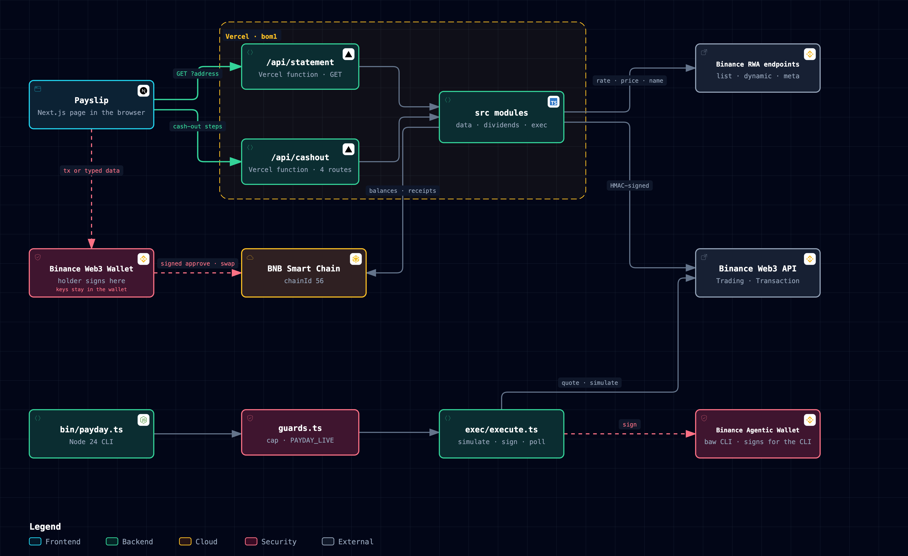
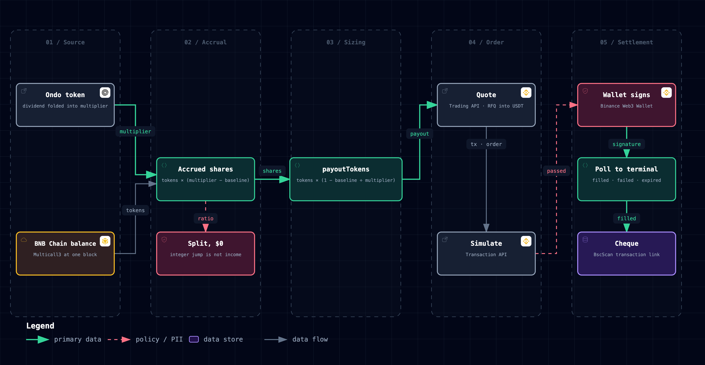

# Payday

**Your stocks have been paying you.**

Payday shows the dividend hidden inside a tokenized stock as an earnings statement, then cashes out exactly that slice from the holder's own wallet.

It is built for income investors outside the US who hold tokenized US dividend stocks on BNB Chain. Ondo's `...on` tokens never pay a dividend into the wallet. They fold it into a share rate, so the balance stays the same while the income piles up out of sight. Payday reads that rate, shows the income in plain English, and sells exactly the dividend portion into USDT.

Live: https://payday-stocks.vercel.app

## The insight

An Ondo token stands for `multiplier` shares of the underlying stock. When the company pays a dividend, Ondo raises the multiplier instead of sending cash. Read from the Binance RWA endpoints on 2026-10-11:

| Token | Multiplier | Meaning |
|---|---|---|
| VZon (Verizon) | 1.0465 | 100 tokens stand for 104.65 shares |
| KOon (Coca-Cola) | 1.0239 | 100 tokens stand for 102.39 shares |
| TSLAon (Tesla) | 1 | pays no dividend, so nothing has accrued |

At that read, 235 of the 458 Ondo tokens on BNB Chain carried a multiplier above 1.

Payday turns the multiplier into three numbers:

```
accruedShares = tokens x (multiplier - baseline)
accruedUsd    = accruedShares x stock price
payoutTokens  = tokens x (1 - baseline / multiplier)
```

`payoutTokens` is the exact slice of the position that carries the dividend. Selling it at the current multiplier realizes exactly `accruedShares`, and the tokens that remain still stand for the shares the holder started with. For 100 VZon from a baseline of 1, that is 4.443 tokens sold and 100 shares kept. `src/dividends/dividends.test.ts` asserts the identity.

## What the holder sees

Paste any BNB Chain address on the home page. Reading needs no wallet.

- **Header.** The address (linked to BscScan), the block the balances were read at, the time of the read, and the uncashed dividends in dollars.
- **Earnings.** One line per Ondo token held: tokens, shares gained since launch, price per share, dollars earned. Lines under $1 fold into a single row.
- **Certificate.** Each token drawn as the share certificate it behaves like, with the dividend sliver at the end of the bar.
- **Cash-out quote.** A live quote for selling the dividend portion into USDT: vendor, expected USDT, price impact, simulation result, market state. When Binance offers no price, the quote says so in a sentence and nothing is signed.
- **Cash out.** The holder connects their own Binance Web3 Wallet, approves if needed, signs the order, and watches it settle.

## How it works



The interactive version is `docs/architecture/architecture.html`, with SVG and PNG exports beside it. The statement is a Next.js app on Vercel (region `bom1`). `/api/statement` assembles the statement from the Binance RWA endpoints and BNB Chain balances. `/api/cashout` prices the cash-out, and `/api/cashout/build`, `/submit` and `/status` walk the cash-out one step at a time. The same `src/` modules also drive a CLI, `bin/payday.ts`, which signs through the Binance Agentic Wallet.

### From dividend to payout



Interactive: `docs/architecture/dividend-to-payout.html`.

1. **Ondo folds the dividend into the multiplier.** The token list and the dynamic price endpoint publish it as `multiplier` and `tokenInfo.sharesMultiplier`. Payday reads the dynamic one, which moves with dividends.
2. **Accrual.** `src/dividends/accrual.ts` computes accrued shares and dollars, and `payoutTokens`.
3. **Quote.** The Trading API prices an RFQ sale of exactly `payoutTokens` into USDT.
4. **Simulate.** The Transaction API simulates the approval or swap that the sale needs. Only a passing simulation reaches the wallet.
5. **Wallet signs.** The holder approves, then signs the order as EIP-712 typed data in their own Binance Web3 Wallet.
6. **Poll to terminal.** The browser polls `/api/cashout/status` every 2 seconds until the order is filled, failed or expired. A still-pending order at 2 minutes counts as failed.
7. **Settled.** The settled quote links its transaction on BscScan.

## Binance Web3 API modules

Requests to `https://web3.binance.com/build` are signed with HMAC-SHA256 (`src/exec/sign.ts`) and issued from `src/exec/web3api.ts`.

| Module | Endpoint | Used for |
|---|---|---|
| Trading API | `GET /api/v1/dex/aggregator/quote` | Price the dividend slice into USDT, RFQ route for Ondo |
| Trading API | `GET /api/v1/dex/aggregator/approve-transaction` | Approval calldata for the token and vendor |
| Trading API | `GET /api/v1/dex/aggregator/swap` | Build the swap or the RFQ typed data to sign |
| Trading API | `POST /api/v1/dex/aggregator/order/submit` | Relay the holder's typed-data signature |
| Trading API | `GET /api/v1/dex/aggregator/order/{orderId}` | Order status until fill, fail or expiry |
| Transaction API | `POST /api/v1/dex/pre-transaction/simulate` | Simulate approvals and swaps before the wallet sees them |

Public RWA endpoints under `https://www.binance.com/bapi/defi` need no key:

| Endpoint | Used for |
|---|---|
| `/v1/public/wallet-direct/buw/wallet/market/token/rwa/stock/detail/list/ai` | Token list for Ondo, xStocks and bStocks with addresses and multipliers |
| `/v2/public/wallet-direct/buw/wallet/market/token/rwa/dynamic/ai` | Live multiplier and stock price |
| `/v1/public/wallet-direct/buw/wallet/market/token/rwa/meta/ai` | Registered company name |
| `/v1/public/wallet-direct/buw/wallet/market/token/rwa/asset/market/status/ai` | Whether the market is open to quote |

The CLI path signs through the Binance Agentic Wallet (`baw`): `market-order`, `sign-message` and `contract-call` (`src/exec/baw.ts`).

## Tokenized stocks

- **Ondo (`...on`), RFQ route.** Statements and cash-outs. VZon, KOon and TSLAon are the reference tokens; any of the 458 Ondo tokens on BNB Chain appears on a statement when the address holds it.
- **xStocks (`...x`) and bStocks (`...B`).** `payday quote <TICKER> <usd>` prices every tokenized version of a ticker side by side: multiplier, price per share, market state and a Trading API quote.

## Safety design

- **The server never signs.** The web app builds orders and holds no key that can sign a transaction. Approvals and swaps go to the holder's wallet through `eth_sendTransaction`, orders through `eth_signTypedData_v4`. `/api/cashout/submit` only relays a signature the wallet produced.
- **The wallet must match the statement.** A cash-out is built only for the connected wallet whose address equals the statement address, compared case-insensitively on the server (`web/lib/cashout-rules.ts`) and again in the browser before any request.
- **$5 floor, $25 cap.** One function, `refuseCashOut`, holds both limits. It runs on the statement value and again on the quoted USDT, so a quote that drifts over the cap is refused too.
- **Simulate first.** Every transaction handed to the wallet has passed the Transaction API simulate for the connected address. A failed simulation never reaches the wallet.
- **Issued quotes only.** `/submit` relays an order only for a quote this server issued to that wallet for that token, within 10 minutes.
- **Market must be open.** A closed market returns a plain sentence and no quote.
- **Poll to a terminal state.** Approvals and swaps are confirmed from the BNB Chain receipt, RFQ orders from the order status. Pending at the 2-minute deadline is a failure, never a fill (`pollToTerminal` in `src/exec/execute.ts` and `settle` in `web/components/payday/wallet-sign.tsx`).
- **Splits are not income.** An integer jump in the multiplier (2x, 10x, within 0.5%) raises `SplitDetected`, and the line is labeled a split instead of counted. A multiplier below 1 is labeled adjusted. Both contribute $0 to net pay.
- **CLI live switch.** `payday statement <address> --cash-out <SYMBOL>` is a dry run. Live needs `--live` and `PAYDAY_LIVE=yes`, a per-trade cap (`--max-usd`), and a signing wallet equal to the statement address (`src/agent/guards.ts`).

## Run it

Needs Node 24 or newer.

```bash
cp env.example .env && chmod 600 .env
# fill BINANCE_W3_API_KEY and BINANCE_W3_API_SECRET in .env
```

Keys come from the Binance Web3 developer portal with the Trading, Market, Wallet and Transaction domains ticked. They stay in the Node server process and never reach the browser.

Web app:

```bash
cd web && npm install && npm run dev
```

The page opens on port 3000. Paste an address to read its statement.

CLI:

```bash
node --env-file-if-exists=.env bin/payday.ts position add 0xYourAddress VZon 100
node --env-file-if-exists=.env bin/payday.ts statement 0xYourAddress
node --env-file-if-exists=.env bin/payday.ts statement 0xYourAddress --cash-out VZon
node --env-file-if-exists=.env bin/payday.ts quote VZ 10
node --env-file-if-exists=.env bin/payday.ts receipts --last 10
```

Live cash-outs from the CLI sign through `baw` (`npm install -g @binance/agentic-wallet@1.10.0`, then log in with a QR scan in the Binance App).

## Tests

```bash
npm test
```

73 tests cover signing, the API client, accrual and split detection, the guards, execution to a terminal state, the position store, and live read-only reads of the Binance RWA and Trading endpoints. The cash-out limits and wallet matching have their own tests:

```bash
cd web && node --test lib/cashout-rules.test.ts
```
